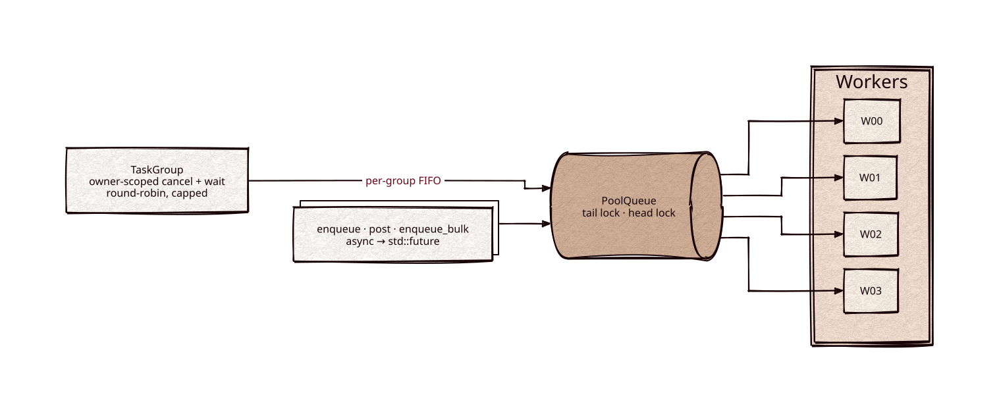

# threadpool

Part of [Kronuz C++ Libraries](https://github.com/Kronuz/cpp-libraries), a collection of small, reusable C++ libraries.

[](https://github.com/Kronuz/threadpool/actions/workflows/ci.yml)
[](LICENSE)


A small, dependency-free C++20 thread pool: a fixed set of named worker threads
pulling tasks from one shared queue, with futures for results and owner-scoped
task groups you can cancel and wait on. For C++ services that need background
workers without pulling in a framework.

`WorkPool` is its scheduler for many owners on one pool: thousands of groups (one per
index, say) take fair turns, queries run ahead of flushes and merges, posting a
caller-owned item allocates nothing, and idle workers sleep on a futex.



## ✨ Highlights

- **Three ways to submit:** fire-and-forget `enqueue`, `enqueue_bulk`, and `async`,
  which returns a `std::future`.
- **Task groups** (`TaskGroup`): cancel what has not started, signal what is
  running through a stop token, and wait for just your own tasks, on a pool other
  owners share. Groups are served round-robin with a per-group concurrency cap.
- **Named workers** (`"W00"`, `"W01"`, …) that show up in debuggers and `top`.
- **Two shutdowns:** `end()` drains the queue first, `finish()` stops as soon as
  possible; `join()` waits with a timeout.
- **State without locks:** `size()`, `running_size()`, and `threadpool_workers()`
  read atomic counters.
- **Pluggable tracing** and thread registration, no-ops by default.
- **`WorkPool` and `WorkGroup`** (`work_pool.hh`): per-group FIFOs served by deficit
  round robin, so one group alone fans out to every worker and many busy groups share
  them equally; three classes (`query`, `flush`, `merge`) with workers reserved for
  queries; `cancel()` that hands the queue back; waits that serve the awaited group instead of
  blocking a worker, and an idle notification for loops and coroutines; Tokio's idle protocol over one futex per worker.

## 📦 Installation

Requires a C++20 compiler (it uses `std::format`), CMake 3.14 or newer, and
pthreads. CI builds it with GCC and Clang on Linux (x86_64, arm64), macOS (arm64,
x86_64), and FreeBSD, plus ASan, UBSan, and TSan builds.

```cmake
include(FetchContent)
FetchContent_Declare(threadpool
  GIT_REPOSITORY https://github.com/Kronuz/threadpool.git
  GIT_TAG        main)
FetchContent_MakeAvailable(threadpool)

target_link_libraries(my_app PRIVATE threadpool::threadpool)
```

`threadpool::threadpool` is a small static library (it compiles `thread.cc`) and
brings `Threads::Threads` with it.

## 🚀 Quick start

```cpp
#include "threadpool.hh"

#include <cstdio>
#include <future>

int main() {
	ThreadPool<> pool("W{:02}", 4);   // four workers, named W00..W03

	pool.enqueue([] { std::puts("fire and forget"); });

	std::future<int> sum = pool.async([](int a, int b) { return a + b; }, 2, 3);
	std::printf("2 + 3 = %d\n", sum.get());

	pool.end();    // let the workers drain the queue
	pool.join();   // and wait for them
}
```

With a task group, scoped to one owner:

```cpp
#include "task_group.hh"

{
	TaskGroup group(pool);
	group.enqueue([](const TaskGroupStopToken& stop) {
		while (!stop.stop_requested() && more_work()) { do_a_chunk(); }
	});
	group.wait();
}   // leaving the scope cancels what has not started and waits for the rest
```

Many owners on one `WorkPool`, with items you own:

```cpp
#include "work_pool.hh"

WorkPool pool;                   // a worker per hardware thread, one kept for queries
WorkGroup index(pool);           // one group per owner

struct Piece : WorkItem {
	int shard;
};
Piece piece;
piece.shard = 7;
piece.cls = WorkClass::query;
piece.run = [](WorkItem* w) noexcept { std::printf("shard %d\n", static_cast<Piece*>(w)->shard); };
index.post(piece);               // no allocation

index.enqueue([] { std::puts("a boxed flush"); });
index.wait();
```

[`examples/demo.cc`](examples/demo.cc) runs a fuller tour: futures, load spread
across workers, the counters, both shutdowns, and `TaskQueue`.

## 🎯 When to use it

- ✅ A fixed pool of long-lived workers for request handling, indexing, or other
  background work, with futures or group-scoped cancellation.
- ✅ `WorkPool`: one pool shared by many owners, with fairness between them, latency
  classes, and high rates of tiny items.
- ❌ `ThreadPool` at very high task rates: its queue is a `std::deque` behind a mutex
  and every enqueue signals a condition variable. Use `WorkPool` there.
- ❌ Work-stealing of fine-grained fork-join work: neither pool steals.
- ❌ Coroutine scheduling: see [task](https://github.com/Kronuz/task).

## 📚 Documentation

- [docs/API.md](docs/API.md): `ThreadPool`, `TaskGroup`, `WorkPool`, `WorkGroup`,
  `Thread`, `TaskQueue`, and the free functions.
- [ARCHITECTURE.md](ARCHITECTURE.md): the worker loop, shutdown, task wrappers,
  `TaskGroup`'s scheduling, `WorkPool`'s rings, turns, classes, and idle protocol, and
  the concurrency model.
- [AGENTS.md](AGENTS.md): repository map, invariants, traps, and how to plug in
  tracing.

## 🛠️ Building and testing

```sh
cmake -B build && cmake --build build && ctest --test-dir build
./build/threadpool_demo
```

## 🤝 Contributing

Issues and pull requests are welcome. Read [AGENTS.md](AGENTS.md) first: it lists
the invariants a change must keep. CI must pass on every platform.

## 📄 License

MIT, Copyright (c) 2015-2019 Dubalu LLC. See [LICENSE](LICENSE). Extracted from
[Xapiand](https://github.com/Kronuz/Xapiand), where it runs the servers, clients,
indexers, committers, and replication workers.
